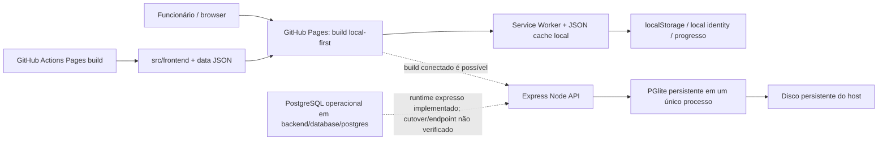
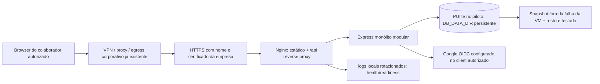

# Arquitetura AWS econômica

Data de preço examinada: 12–13/10/2026. Todos os cálculos em USD, 730 horas/mês, tarifa Linux sob demanda, sem impostos, créditos, savings plans, domínio/certificado cobrado, horas de trabalho, operações extraordinárias, restauração ou crescimento de rede. Valores oficiais foram lidos dos catálogos públicos AWS de EC2/Lightsail para `sa-east-1` e `us-east-1`; não houve acesso à conta AWS nem execução do Pricing Calculator dentro da conta da A3Data. Ver JSON de origem em `docs/audits/evidence/2026-10-13/`.

## Situação atual no código

O build Pages do checkout é explicitamente `local-first`. `API` com PGlite existe no repositório, mas nenhum serviço público ou local fora desta execução foi consultado; linhas pontilhadas significam configuração/caminho opcional, não serviço ativo confirmado. Railway aparece em históricos e docs, mas sua disponibilidade/estado atual não foi verificada. Não assumir qualquer conta, volume ou domínio remoto.

## Proposta quando o ingresso corporativo for definido

Esta arquitetura de menor custo atende **somente** se a borda corporativa existente restringir também arquivos estáticos e requests diretos à API, não apenas o cookie/token da UI. A rede da A3Data, SSO/proxy, egress, domínio e certificados não são conhecidos pelo repositório e não foram simulados. CORS, `AUTH_ALLOWED_DOMAINS` e login não bloqueiam downloads feitos de fora. Se esse perímetro não puder ser confirmado, não expor essa arquitetura; apresentar ao time de rede existente e manter sem usuário real até a decisão.

Na primeira instalação de staging, usar apenas dados sintéticos, interface/identidade restritas aos testers autorizados e alerta de gasto existente. Nginx serve o build `public/` e encaminha `/api` para Node em `127.0.0.1:3001`. Um service manager inicia o processo, valida health/readiness e faz stop gracioso. O diretório de DB fica em volume persistente separado do diretório de releases. `DB_ENGINE=pglite`; só um processo pode abrir o diretório. Bloquear 3001 público e aceitar apenas 443 na fronteira corporativa/ingress aprovado e SSH pelo fluxo de administração aprovado.

Se houver requisito que impeça PGlite ou demandar mais concorrência multiwriter, usar `DB_ENGINE=postgres`, PostgreSQL 16 local na mesma VM, TLS com CA verificada, pool máximo inicial 5, role runtime sem DDL. Manter o mesmo processo Node e nginx. As operações admin/schema rodam por procedimento separado e credencial efêmera; o runner `postgres-test` não é produção. Migração da origem permanece fora dessa etapa e exige o seu próprio inventário e restore.

## Componentes

| Necessário | Uso | Fase |
|---|---|---|
| Uma VM Lightsail OU EC2 | Nginx, SPA/PWA, Express, PGlite ou PostgreSQL | Staging privado e piloto, conforme acesso corporativo |
| Disco persistente | Sistema, DB, releases e espaço temporário controlado | Ativo desde o piloto; preservar em atualizações |
| IPv4 ou conexão privada corporativa | DNS, TLS e acesso dos browsers | Confirmar política de rede e custo/allowance antes de criar |
| Segredos já aprovados | HMAC, Google client ID, DB URI/CA quando PostgreSQL | Fornecer no runtime, fora de Git/artifact |
| Backup fora da VM e teste restore | Recuperar host apagado, corrupção e erro operacional | Gate antes de histórico real |
| Logs rotacionados e endpoint de liveness/readiness | Operação mínima | Inicial |

| Dispensável neste tamanho/estágio | Motivo técnico |
|---|---|
| ALB/NAT Gateway/EKS/ECS/Fargate/Kubernetes | A API é um único monólito e não tem dependência que prove multi-AZ/scale-out; custo e superfície excedem requisito |
| RDS | Requisito exclui nesta etapa; PostgreSQL no host atende se o runtime for aprovado, com manutenção manual assumida |
| DynamoDB/Redis/ElastiCache | Fluxo usa SQL relacional, transações e queries atuais; reimplementar não melhora risco/total comprovado |
| Iceberg/data lake writer | Não é banco operacional de login, quizzes e progresso |
| CloudWatch Logs customizados, APM pago, analytics de usuário | Sem volume/requisito; começar com logs sanitizados rotacionados e monitoramento já contratado |
| Bucket público / CloudFront público | Não atende o requisito de que bancos/recursos só cheguem a funcionários autorizados |

## Dimensão, observada e reservada

Medições observadas estão em Windows x64 i5-1135G7, Node 24.14.0, memória 13,8 GiB, PGlite com 40 questões sintéticas, login sintético, 10 questões por quiz, API, load driver e banco no **mesmo processo**. Node+PGlite pós-schema usou cerca de 557–567 MB RSS e 37 MB de heap; pico RSS sampled nas cargas originais foi 568 MB (10), 575 (30), 568 (50), 601 (150). O Node/E2E não exercitou certificado Google, rede do browser corporativo, cache de proxies, VM, Linux/ARM, dados completos importados ou atividade sustentada. `process.resourceUsage().maxRSS` chegou aproximadamente 1,05 GiB: é pico lifetime (inclui inicializações/dump/restore temporário), não nível normal nem um segundo componente a somar.

CPU do processo em rajadas até 50 usuários ficou em média aprox. 1,16–1,29 core do PC e p95/p99 HTTP subiu de 173/176 ms para 642/704 ms. Load generator consome uma parte desse CPU. No ensaio original de 150 distintos, 150 quizzes/1.500 answers finalizaram em cerca de 32 s com p95 ~1,86 s e pico RSS ~601 MB; repetir depois do ajuste de limiter teve falha parcial cuja causa está no log de diagnóstico, então **não usar como aceite pós-fix** até regressar. No ensaio compartilhando IP anterior à correção, 30 tentativas foram bloqueadas em 429. Após a correção, o unit/integration contract específico de rate limit comprova isolamento por sessão e fallback de IP; não é teste de carga simultânea em VM.

Plano de capacity test antes da escolha de capacidade: mesma sequência login, home, `/api/questions`, `/api/quiz/start`, 10 respostas, finish/results, dashboard/stats e persistência; 10/30/50/150 simultâneos em EC2/Linux alvo com fixtures fixas, run de pelo menos 30 minutos e soak. Registrar RSS de `node`, heap/external, CPU EC2, `process.cpuUsage`, CPUCreditsBalance/usage, memory do SO/PostgreSQL, free disk/IOPS/throughput EBS, p50/p95/p99, requests/sec/429/5xx, conexões e tamanho/IO de banco. Testar restart gracioso, SIGKILL em fixture, host restoration e dump+restore em VM separada. Estabelecer SLO e teto mensal com donos do produto.

| Camada | Observação / hipótese inicial | Reserva sugerida e limite |
|---|---|---|
| Arquivos frontend | 213 arquivos, 7,35 MB origem; gzip estimado por asset ~1,77 MB; sem comprimir no servidor de medição | Nginx gzip/brotli depois de validar header/cache; tráfico e compressão não foram medidos no host |
| Node/Express | PGlite está no mesmo processo; heap live até ~138 MB ao cenário original de 150, RSS ~601 MB | Reservar 1 GiB de RAM para Node + runtime PGlite; sem worker/processo paralelo |
| PGlite | Pós-inicialização ~439 MB `external` do runtime WASM na mesma RSS; base fixture ~41 MB; save cresce com resultados | Cabe em 4 GiB sob essa fixture; volume inicial 40 GB e alertas de free disk; nenhuma extrapolação para dataset real sem medir |
| PostgreSQL no mesmo host (alternativa) | F1–F4 testados com PostgreSQL efêmero, sem medida de memória sustentada de prod | 4 GiB para começar; PostgreSQL shared buffers 0,5–1 GiB, pool 5; validar após instalar antes de declarar 150 simultâneos |
| OS/Nginx/proxy/backup | Não medidos em VM | Estimar 0,5–1,0 GiB Linux/Nginx/cache e deixar ~1 GiB de margem; snapshot/dump precisa espaço temporário e nunca encher filesystem |
| Capacidade | 10,30,50 passaram no ensaio pre-limiter; 150 alcançou mas não repetiu com limiter pós-fix; toda carga fechada | 4 GiB candidato de piloto, não compromisso de capacidade; 8 GiB só se profiling/soak mostrar pressure, swap, latência ou recuperação fora do gate |

CPU credits mudam a escolha: t4g.medium tem 2 vCPUs, base 20% por vCPU e créditos inclusos de 24/h; t4g.large tem 2 vCPUs, base 30% e 36/h. Em rajadas de uso em excesso, créditos guardam burst. Um serviço com CPU continuamente alta, num processo single-threaded, pode esgotar crédito/usar Unlimited; não dimensionar pelas médias curtas do laptop. PostgreSQL em mesma máquina contende por CPU/IO/RAM com a API. O app usa transações e limites SQL; maior CPU não corrige bloqueio de event loop ou uma query ruim.

## Comparação dos quatro cenários

Custos mensais calculados logo abaixo são capacidade 24×7, 730h, 20 GB de snapshot médio faturável para exemplo, 40 GB gp3 na EC2. Capacidade simultânea é sempre **não comprovada para nuvem**. Sinalizar rede externa, taxes, rota IPv4 e descontos na Calculadora oficial antes de qualquer conta.

| Cenário/região | vCPU/RAM | Disco | Computação | Disco + backup + IPv4 | Total mensais indicativos | Capacidade | Trabalho / manutenção |
|---|---|---|---:|---:|---:|---|---|
| 1. Lightsail 4 GB `sa-east-1` | 2 shared / 4 GB | 80 GB SSD incluido | $23,54 | snapshot $1,00; IPv4 incluido | **$24,54** + impostos/overage | piloto 10-30 candidato, sujeito ao ensaio; 150 não aceito | baixo-médio / médio para persistência/OS |
| 1. Lightsail 8 GB `sa-east-1` | 2 shared / 8 GB | 160 GB SSD incluido | $43,16 | snapshot $1,00; IPv4 incluido | **$44,16** + impostos/overage | memória maior; CPU segue 2 vCPU compartilhadas | baixo-médio / médio |
| 1. Lightsail 4/8 GB `us-east-1` | 2 shared / 4 ou 8 GB | 80/160 GB SSD incluído | $23,54 / $43,16 (rate catalog 730h; página publica plano $24/$44) | snapshot $1; IPv4 incluído | **$24,54 / $44,16** (rate model) | Igual teste; maior latência transatlântica e não reduz exigência de acesso | baixo-médio / médio |
| 2. EC2 t4g.medium + 40 GB gp3 + snapshot 20 GB `sa-east-1` | 2 Graviton / 4 GiB | $6,08 gp3; baseline 3.000 IOPS/125 MB/s | $39,13 | $6,08 + $1,36 snapshot + $3,65 IPv4 | **$50,22** | Não comprometida; mid-scale após soak | médio / médio-alto: patch, backup, networking |
| 2. EC2 t4g.medium `us-east-1` | 2 Graviton / 4 GiB | 40 GB gp3 $3,20 | $24,53 | $3,20 + $1 snapshot + $3,65 IPv4 | **$32,38** | Não comprometida; mais distância aos funcionários | médio / médio-alto |
| 2. EC2 t4g.large + 40 GB gp3 + snapshot 20 GB `sa-east-1` | 2 Graviton / 8 GiB | $6,08 | $78,26 | $6,08 + $1,36 + $3,65 | **$89,35** | Cabe mais cache/margem, mesma CPU count e ainda requer teste | médio / médio-alto |
| 2. EC2 t4g.large `us-east-1` | 2 Graviton / 8 GiB | $3,20 | $49,06 | $3,20 + $1 + $3,65 | **$56,91** | Mesmo limite de 2 vCPU | médio / médio-alto |
| 3. EC2 + PG local | Mesmas duas classes acima | mesmo 40GB gp3 + snapshot | mesmo custo EC2 | igual, possivelmente maior snapshot a validar | **$50,22/$89,35** Brazil; **$32,38/$56,91** US | Concorrência transacional melhora; sem benchmark VM não assumido | alto / alto; duas stores processadas no host |
| 4. Static S3 + CloudFront e VM API/DB | VM ainda necessária; memória/cpu não removidas | S3 storage/requests, HTTPS/distribuição, VM disk e snapshots | mesmo valor VM até medir reallocation | Acrescentar S3, CloudFront, DNS/security monitor e transferência regional; somar em Calculator | **Delta mensal não fechado** | Não altera capacidade da API/DB comprovada | médio-alto / médio |

EC2 custos não incluem tráfego público além da franquia da conta. Para EC2, rede inter-AZ não prevista, sem NAT/ALB. EBS gp3 contempla baseline técnico citado, não throughput extra. Snapshots AWS são incrementais; 20 GB é uma entrada de estimativa, não volume restaurado garantido. Lightsail cobra `$0.05/GB-month` de snapshot; preço/catalog regional de EC2 snapshots para Brazil `$0.068/GB-month`, Virginia `$0.05`. Snapshot de VM sem app/database consistente requer fechar DB e guardar referência/imutabilidade; incluir restore em ambiente separado. Endpoint público EC2: IPv4 $0.005/h. Perfil TLS/certificado em Nginx depende domínio DNS existente; Let's Encrypt não inclui custo da operação. Não se inclui mão de obra em moeda pois custo/hora A3Data é desconhecido.

Rede transferida pode dominar frontend público: Lightsail São Paulo tem allowance menor (2 TB aplicável ao bundle), mas os artefatos em si são ~1,77 MiB comprimidos. Imagens/JSON/cache hit/CDN, respostas API e quantidade de sessões não foram observados em browser público. A VM não é alternativa pública à política corporativa: firewall corporativo, VPN, proxy ou SSO existente precisa ser identificado primeiro.

## PGlite ou PostgreSQL

| Item | PGlite | PostgreSQL 16 na própria VM |
|---|---|---|
| Integração hoje | Padrão real em `db.js`; startup prepara/migra schema existente; persistência por filesystem | Runtime operacional adicionado; entry `DB_ENGINE=postgres`; deve usar `DATABASE_URL`, TLS e papel sem DDL |
| Concorrência | Um engine e filesystem; não distribuir writers em servidores; serialização/locks do mesmo processo | pool multi-connection e isolamento relacional; suites duas conexões verificam quiz, último ADMIN, identidade e scope editorial |
| Memória | medição local indica ~557–601 MB RSS em fixture atual; wasm aparece em `external` dentro de RSS | incremento RAM real ainda não medido; reservar shared_buffers e Node em 4 GiB, medir antes de aprovar |
| Recovery | dump precisa fechada/coordenação compatível; snapshot do diretório é mesma dependência física | `pg_dump`/snapshot com transação/consistência; mais runbook, WAL/point-in-time se negócio exigir |
| Operação | menor custo/complexidade; host/processo único e checkpoint recuperação manual | mais concorrência e caminho estável PG; patch/minor upgrade, schema provisioning, monitoramento, senha/CA e backup aumentam operação |
| Conclusão | Adequado a piloto controlado single writer se passarem restore/segurança e se não for prometida HA | Escolher se prova funcional multiwriter ou RPO/RTO não atendido por PGlite; não ativar por ser mais moderno |

`150 cadastrados` significa conta ativa/possível, não 150 simultâneos. Memória do PGlite não subiu linearmente com concurrency, porque o engine é inicializado uma vez; isso é evidência de que cada usuário NÃO abre outro banco, não de que concorrência tem latência independente. Pico p95 do workload, CPU e eviction/cache precisam SLO corporativo para decisão.

## Segurança e crescimento

1. **Gate 0:** business owner confirma políticas de dados, user provision/allowlist e URLs disponíveis apenas para funcionários autorizados. Time de rede/IdP verifica edge que restringe estático + API e TLS; não inferir em CORS.
2. **Staging sintético:** endpoint HTTPS interno, sem dados pessoais/migrados, perfil A/B e ADMIN, estático bloqueado fora do edge; testar token inválido/expirado, revoke, sessões, quotas e 403 transversal.
3. **Persistência:** comprovar host restart, disk retain, crash, backup offline/external, restore em destino isolado, checksums/contagens/foreign keys, RPO/RTO aprovados. Nunca apontar restore para única cópia.
4. **Carga Linux:** rodar 10/30/50/150; só anunciar janela validada, limite de usuários e custo fixo após teste/soak e leitura de CPU credits/disk/HTTP.
5. **Crescer** Lightsail 4→8 GB ou EC2 medium→large quando o limite medido pedir memória. Carga alta sustentada demanda profiling/query ou classe de CPU diferente; não trocar banco por cache sem evidência. Adotar PostgreSQL local quando as transações/concorrência se beneficiarem e operação+backup forem aceitas; migrar dados somente via trilha F6 e rollback.
6. **Front separado** só após medição que demonstre CPU/memória suficiente ou obrigação de delivery. Dados protegidos requerem serviço privado/federado já disponível; distribuição CDN por si só é pública.

## Evidência de preço

- AWS Amazon Lightsail Linux regional offer: bundles 4 GB (2 vCPU, 80 GB SSD) e 8 GB (2 vCPU, 160 GB); São Paulo e N. Virginia; 4/5 TB indicados no bundle, com aviso de allowances regionalizadas na metade em São Paulo. Rate catalog: $0,03225/h e $0,05913/h.
- Amazon EC2 On-Demand public offer CSV version retrieved 12/10/26: t4g.medium/large e gp3/snapshot. AWS IPv4 pricing page: $0,005 por IPv4-h.
- Lightsail snapshot official pricing page: $0,05/GB-month. AWS EBS pricing page: snapshots e gp3 pricing differ by region; public EC2 catalog csv gives regional numbers above.
- T4g AWS docs: base performance/credit rates 20%/24 for medium, 30%/36 for large; unlimited credit $0,04 per vCPU-hour.
- Links externos específicos estão no relatório principal/evidence. O custo assume pagamento contínuo, não reserva, não créditos de free-tier temporário nem billing constructs de organização A3Data.

## Security and staging validation addendum

The minimum staging design remains Nginx + Express + PGlite on one host, but the virtual host stays inaccessible until A3Data approves corporate connectivity and installs real CIDRs in the access map. Hardened API binds to `127.0.0.1`, requires an individually configured allowlist, and protects content reads. TLS, real identity/allowlisting, and encrypted off-host backup need operational validation. The Linux 2 vCPU/4 GiB limit passed the synthetic functional matrix, but p99 at 150 concurrent users was 28.8 s and is not accepted capacity. Evidence and Nginx/systemd/backup templates are in [ETAPA2_STAGING_PGLITE.md](ETAPA2_STAGING_PGLITE.md); no Lightsail or EC2 was provisioned or validated.

Final local validation passed 98 Jest suites/841 tests (107 conditional skips), 55/55 E2E, isolated F3 PostgreSQL, and post-format API/security suites 77/77. Linux 2 vCPU/4 GiB synthetic matrix passed functionally but p99 at 150 concurrent was 28.8 s; AWS instance/ARM/network/storage were not tested. Backup archive encryption/off-host restore and network/TLS remain external gates. See [ETAPA2_STAGING_PGLITE.md](ETAPA2_STAGING_PGLITE.md).

## Preço oficial atualizado (13/10/2026)

A página/lista oficial consultada aponta Lightsail Linux com IPv4 por US$ 24/mês (4 GB) e US$ 44/mês (8 GB); snapshots são US$ 0,05/GB-mês, então 20 GB adicionam cerca de US$ 1. Para EC2, a captura do catálogo oficial de 12/10/2026 dá `t4g.medium` US$ 0,0336/h (`us-east-1`) e US$ 0,0536/h (`sa-east-1`); com 730 h, 40 GB gp3, snapshot de 20 GB e IPv4, estimativa total US$ 32,38 e US$ 50,22. `t4g.large` nos mesmos critérios: US$ 56,91 e US$ 89,35. Isso exclui impostos, egress extra, backup externo e operação. A franquia Lightsail é regionalizada e precisa ser verificada com a rede da A3Data; validar o total na AWS Pricing Calculator antes de qualquer provisionamento. Esta referência substitui a estimativa anterior de Lightsail US$ 24,54.
