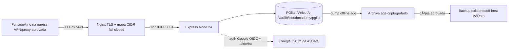

# Etapa 2 — bloqueadores para staging interno com PGlite

Data: 13/10/2026 · HEAD revalidado: `ef3140432ec5ccd5f6b14098f77e5e73c4ad69b6` · Dados usados: fixtures sintéticas. Nenhuma credencial real, base preexistente, conta AWS, volume remoto ou destino corporativo foi acessado.

## Decisão e situação

O caminho segue com Express monolítico + PGlite em um processo + Nginx, em host único com 2 vCPU/4 GiB. O PGlite permanece padrão. Agora o runtime de staging/produção exige uma lista explícita de emails, revalida essa autorização em cada request autenticado e escuta somente em `127.0.0.1`. As APIs de questões, cases, serviços e leaderboard também exigem sessão nos ambientes hardened. O frontend e os JSONs completos continuam sendo arquivos estáticos: o exemplo Nginx nega todo acesso até que a equipe de rede instale uma lista real aprovada de egress/VPN/proxy.

**Situação: pronto no código para ser configurado em staging sintético; staging ainda está No-Go operacional** até que A3Data forneça domínio, tester individual autorizado, OAuth, hostname/certificado e rede de entrada aprovados. Não criar usuário de staging via endpoint legado nem usar `X-Test-Role` fora de Jest.

## Tabela única de correções e gates

| Prioridade | Bloqueador                                                                                  | Arquivo e função                                                                                                                                                                | Alteração efetuada                                                                                                                                                                                                                               | Teste                                                                                                                                                  | Resultado                                                                                                                                                                               | Pendência                                                                                                                                                                           |
| ---------- | ------------------------------------------------------------------------------------------- | ------------------------------------------------------------------------------------------------------------------------------------------------------------------------------- | ------------------------------------------------------------------------------------------------------------------------------------------------------------------------------------------------------------------------------------------------ | ------------------------------------------------------------------------------------------------------------------------------------------------------ | --------------------------------------------------------------------------------------------------------------------------------------------------------------------------------------- | ----------------------------------------------------------------------------------------------------------------------------------------------------------------------------------- |
| P0         | Identidade Google aceitava qualquer email do domínio e criava conta                         | `backend/api/services/googleIdentity.js:isEmployeeEmailAuthorized`, `verifyGoogleIdToken`; `backend/api/routes/auth.js:POST /google`; `backend/api/config.js:validateApiConfig` | `AUTH_ALLOWED_EMAILS` obrigatório, validado e fail-closed em staging/production; só identity allowlisted pode provisionar/entrar; não atribui autorização por domínio sozinho                                                                    | Google OIDC/allowlist + config e rota, parte de 56 testes direcionados                                                                                 | PASS: autorizado exato entra; fora da lista retorna 403 antes do upsert; ausência lista impede configuração/identidade                                                                  | A3Data deve escolher IdP/grupo ou owner e entregar lista individual/test identities; configuração é operada por deployment owner, sem UI de autogestão                              |
| P0         | Funcionário removido continuaria usando token até oito horas                                | `backend/api/middleware/requireRole.js:requireAuth`                                                                                                                             | Após token HMAC e leitura do usuário ativo, checa allowlist em cada request; remoção corta API na próxima chamada; conta inativa segue 401                                                                                                       | `auth401.test.js` revoga com token ainda válido e testa conta desativada; `sessionToken.test.js` valida expiração                                      | PASS: remoção 403 imediato, conta desativada 401; expiração server-side validada                                                                                                        | A lista precisa ser atualizada ao desligamento; offline armazenado no browser não pode ser revogado pela API                                                                        |
| P0         | Arquivos HTML/JS/JSON acessíveis sem identidade e dados pessoais em leaderboard GET público | `docs/audits/staging/nginx/cloudacademy.conf.example`; `requireEmployeeForApi` em `questions.js`, `cases.js`, `server.js`                                                       | Nginx aplica allowlist de rede a todo o vhost; API exige sessão para leitura de questions, case, dialogues/events, services e leaderboard em staging/produção; endpoints pessoais já exigiam auth e escopo do dono/admin                         | `deploySafety.test.js`: GET anônimo de questions/cases/services/leaderboard em staging e prod → 401; E2E local-first 55/55                             | PASS em API; config Nginx requer inspeção no host antes de staging                                                                                                                      | Ingress real, teste externo de URL direta e revisão da classificação dos dados são da rede/segurança A3Data                                                                         |
| P0         | Porta API estava vinculável fora do host                                                    | `backend/api/config.js`, `backend/api/server.js:startServer`                                                                                                                    | `NODE_ENV=staging                                                                                                                                                                                                                                | production`força bind`127.0.0.1`; desenvolvimento mantém `0.0.0.0`; Nginx encaminha loopback/3001                                                      | `apiOperations.test.js` e `deploySafety.test.js` conferem bind de loopback                                                                                                              | PASS de config; socket real e Security Group ainda não foram implantados/inspecionados                                                                                              | Confirmar em staging `ss -lntp`, firewall e inexistência de listener público 3001 |
| P0         | Dados estáticos protegidos podiam escapar por cache offline após autorização/revogação      | `src/frontend/pwa/sw.js` analisado; config Nginx/documento                                                                                                                      | Não foi desativada cache offline nem alterado comportamento local-first; arquivos baixados podem permanecer no Cache API/instalação até limpeza gerida pelo endpoint                                                                             | E2E PWA offline passa no conjunto; não há teste de wipe remoto por design                                                                              | RISCO EXPLICITADO, sem promessa de revogação de cópias offline                                                                                                                          | Classificar banco de questões; usar endpoints geridos e ciclo de limpeza de dispositivo corporativo se conteúdo exigir revogação. Remover dispositivo/rede não apaga cópia já feita |
| P0         | Concorrência, crash e backup/restore de PGlite sem prova de falha abrupta                   | `scripts/diagnostics/pglite-crash-recovery.mjs`; `scripts/operations/backup-pglite.mjs`; `verify-pglite-backup.mjs`                                                             | Smoke força término de processo em transação aberta; backup opera somente após serviço parado, `syncToFs()` + `dumpDataDir('gzip')` oficial do PGlite e criptografia em stream com `age`; restore descriptografa em memória e exige destino novo | Crash sintético PASS; teste carga local `dumpDataDir`/restart/restore PGlite PASS; `node --check` dos dois utilitários PASS                            | Crash: transação commitada preservada, transação aberta desfeita, gravação posterior preservada. Criptografia `age` não executada porque binário não está instalado                     | Instalar/aprovar `age`, fazer cópia criptografada para destino off-host autorizado e testar restore com identidade/chave administrativa separada; retenção, RPO/RTO da A3Data       |
| P1         | 150 ativos não representados por dimensionamento Linux limitado                             | `scripts/diagnostics/deploy-resource-audit.mjs`, `run-linux-load.sh`                                                                                                            | Saída configurável via `AUDIT_OUTPUT_PATH`; capturas sintéticas incluem CPU, RSS/heap/external, latência, I/O de DB, startup, dump/restart/restore e consistência                                                                                | Matriz completa Linux Node 24 sob `--cpus=2 --memory=4g`; log `resources-linux-full-stage2.json` | 10/30/50/150 e 30 shared IP passaram. 150: 2.700 requests, 1.500 respostas, zero duplicatas; p50 441 ms, p95 3,30 s, p99 28,80 s, RSS 672 MiB. Rajada sintética, sem SLO | Soak no host escolhido, workload browser/think time e dados representativos, medir OS/disco/IOPS/egress e definir limites com owner |
| P1         | Timeout sidebar anterior no E2E                                                             | `e2e/navigation-smoke.spec.js`; inicialização de sidebar em `src/frontend/js/shell.js`                                                                                          | Nenhum bug/corrida de produto reproduzido; havia build concorrendo com E2E e o caso passou em execução isolada e suite consolidada sem rebuild                                                                                                   | `node e2e/run-playwright.mjs` no build estável                                                                                                         | PASS 55/55, 4,1 min; `navigation-smoke` 4/4. Execução em child process exigiu Docker/Playwright fora do sandbox Windows                                                                 | Manter serialização no CI: build uma vez, aguardar saída final e só então iniciar Playwright; observar flake no runner CI real                                                      |
| P1         | Staging não tinha proxy TLS nem padrão de bind seguro publicado                             | exemplos `staging/nginx/*`, `staging/systemd/cloudacademy-api.service.example`                                                                                                  | Vhost exige range corporativo, TLS, proxy loopback; service exemplo tem env externalizado, PGlite persistente e hardening systemd/cgroup                                                                                                         | Revisão estática; `nginx -t` não disponível neste Windows, valores do certificado/rede não existem                                                     | Template fail-closed; não considerado homologado                                                                                                                                        | Preencher com host e CIDRs da empresa, `nginx -t`, testar HTTPS, 403 de fora, 3001 somente loopback e SIGTERM no Linux alvo                                                         |
| P1         | Evidência de API Postgres após alterações comuns                                            | backend comum `requireRole` e server                                                                                                                                            | O runtime selecionado segue PGlite; teste PG-test não é deploy                                                                                                                                                                                   | F1/F2/F3/operational anteriores PASS antes desta rodada; pós-change F3 ainda a repetir se o command final não estiver em evidência                     | Não declarar regressão PG ou aceite deste caminho para deploy PGlite                                                                                                                    | Repetir `npm run test:postgres:api` se API compartilhada for gate de CI; nunca iniciar `postgres-test` em produção                                                                  |

## Recursos públicos e protegidos

No vhost corporativo, **todas as rotas** (HTML, `/js`, `/css`, imagens, `/data/*.json`, manifest, Service Worker, `/api/*`) devem passar pelo `geo` fail-closed. Não existe login em Nginx nesta proposta; a borda por rede protege o transporte e a allowlist+HMAC protege API/account. Só health/readiness mínimos poderiam ser exceção se o monitor de host realmente precisar, mas esta configuração não cria exceção: tudo permanece no mesmo vhost restrito.

As rotas API de conteúdo passam a exigir sessão no staging e produção. `/api/auth/google` e `/api/auth/login` ficam roteáveis para permitir a tentativa de login, mas email-only login continua 403; health e readiness respondem apenas status. Rotas de perfil/estado, quizzes/results, estatística individual, acesso e editoria já exigiam usuário e/ou role, inclusive comparação de user ID nas rotas por `:id`.

Dados baixados pelo PWA não têm revogação remota confiável. `sw.js` pré-cacheia páginas shell e assets, guarda alguns JSON lazy e explicitamente exclui `/api`. Remover email da allowlist revoga requests API na primeira chamada seguinte e bloquear a VPN impede novos downloads, mas um browser que já instalou os caches pode continuar lendo a cópia local. Se o conteúdo for confidencial, staging deve usar endpoint gerido e browser/dispositivo gerido com limpeza, ou a empresa deve decidir se aceita essa característica offline; não declarar que logout/cache-control exclui dados já baixados.

## Procedimento reproduzível de staging sintético

Pré-requisitos da A3Data: domain/hostname approved, um Google tester ou test tenant emitido pela equipe de identidade, OAuth Client ID e redirects configurados por essa equipe, CIDRs reais da VPN/proxy que chegam ao host, certificado TLS, rede/firewall, dono operacional e destino de backup. Não popular qualquer placeholder com valores inventados.

1. Criar uma instância vazia 2 vCPU/4 GiB com Linux x86-64 para baseline (ARM Graviton só depois de validar imagens/Node/dependências). Registrar AMI/kernel, Node 24 LTS exato, arquitetura e filesystem. Não restaurar volume ou backup de outro ambiente.
2. Instalar release de um checkout/tag auditado e `npm ci --omit=dev`; gerar `public/` com `PUBLIC_API_BASE_URL=https://<host aprovado>` e o client ID público aprovado. Só conteúdo versionado/sintético no PGlite vazio. Manter dados e releases em caminhos distintos.
3. Criar `/etc/cloudacademy/api.env` root-owned (0600) com `AUTH_SESSION_SECRET` aleatório >=32 bytes, `GOOGLE_CLIENT_ID`, `AUTH_ALLOWED_DOMAINS` aprovados, `AUTH_ALLOWED_EMAILS` contendo somente o tester nominalmente aprovado, `CORS_ALLOWED_ORIGINS=https://<host>`, `TRUST_PROXY=127.0.0.1`. Não guardar arquivo no Git, AMI pública, artefato frontend ou log. Em caso de allowlist vazia/malformada, a API deve falhar no startup.
4. Criar `/var/lib/cloudacademy/pglite` com owner `cloudacademy`; manter volumes persistentes fora das pastas releases. Instalar o serviço systemd fornecido e confirmar `DB_ENGINE=pglite`, readiness e bind `127.0.0.1:3001`. O exemplo limita o processo a 2 CPU/3 GiB, reservando pelo menos 1 GiB de host para SO/Nginx/cache.
5. Instalar Nginx com o template, TLS real e o arquivo CIDR só depois da equipe de rede informar ranges/egress. Firewall da Lightsail ou Security Group da EC2: 443 para a origem corporativa aprovada; 80 somente se redirecionamento corporativo exigir; 3001 nunca inbound. Administração por mecanismo existente; não abrir SSH público genérico. Nginx sobre HTTPS define XFF e encaminha somente a `127.0.0.1:3001`.
6. Executar `nginx -t`, conferir `ss -lntp` (3001 loopback; 443 Nginx), acessar pela rede de tester, e tentar os mesmos HTML/JS/JSON/API por dispositivo fora da VPN. Esperar 403/negação também para URL direta. Fazer login de tester, expirar token, remover email da lista e verificar 403 API sem esperar oito horas; adicionar usuário não autorizado e verificar 403 sem provisionamento.
7. Percorrer smoke E2E / fluxo real com dados sintéticos: home/login/logout, idioma, simulados/respostas/finalização/resultados, diagnóstico, dashboard, flashcards, revisão, jornada, XP, Cases/Labs, perfil, configurações, expiração, PWA update/cache e A/B; acessar objetos do outro usuário e esperar 403/404 sem dados. Checar logs sanitizados.
8. Antes de parar staging, realizar backup encrypted + cópia off-host e restore numa pasta/host separado; comparar tabelas e contagens, executar cenário de rollback de release sem trocar/apagar diretório DB. Nomear e registrar os responsáveis pelo exercício.
9. Não usar dados pessoais reais nem convidar funcionários gerais até os gates de elegibilidade, rede e classificação no checklist serem aprovados.

## Exemplo de serviço e Nginx

Os arquivos prontos para revisão estão em [`staging/nginx/cloudacademy.conf.example`](staging/nginx/cloudacademy.conf.example), [`staging/nginx/approved-cidrs.map.example`](staging/nginx/approved-cidrs.map.example) e [`staging/systemd/cloudacademy-api.service.example`](staging/systemd/cloudacademy-api.service.example). O mapa retorna deny por padrão. Sem o include real, o Nginx não inicia; esse comportamento é intencional. O service injeta config em `/etc/cloudacademy/api.env`, mantém PGlite em `/var/lib/cloudacademy/pglite`, reinicia em falha e usa SIGTERM para encerrar.

Após instalar os arquivos reais, validações mínimas: `sudo nginx -t`; `sudo systemctl daemon-reload`; `sudo systemctl start cloudacademy-api`; `sudo systemctl status cloudacademy-api`; `sudo ss -lntp | grep ':3001'` deve mostrar apenas `127.0.0.1:3001`; `curl -fsS https://<host-aprovado>/api/health`; tentativa fora da rede deve dar 403. A linha 443/firewall e os intervalos são decisões da equipe de rede; exemplos não abrem qualquer faixa.

## Backup externo e restauração

`PGlite.dumpDataDir('gzip')`, `syncToFs()` e `loadDataDir` existem na API de tipos da versão instalada `@electric-sql/pglite` 0.5.1; o diagnóstico local exercitou dump, restart e load em outro diretório. **Não copiar arquivo/data directory enquanto a API está ativa.** O utilitário `scripts/operations/backup-pglite.mjs` exige que a API esteja parada, abre o diretório exclusivo, sincroniza FS, produz archive gzip, fecha o engine e passa o buffer ao `age` por pipe; mantém apenas `.tar.gz.age` final e informa SHA-256. O destinatário público `BACKUP_AGE_RECIPIENT` não é segredo. A private identity fica fora do host/API, controlada pela equipe que faz restore.

Exercício controlado (usar somente staging sintético até aprovado):

```bash
sudo systemctl stop cloudacademy-api
sudo systemctl is-active cloudacademy-api # esperado: inactive
sudo -u cloudacademy env \
  DB_DATA_DIR=/var/lib/cloudacademy/pglite \
  BACKUP_OUTPUT_DIR=/var/tmp/cloudacademy-backup \
  BACKUP_AGE_RECIPIENT='<recipient público aprovado>' \
  node /opt/cloudacademy/current/scripts/operations/backup-pglite.mjs
```

Copiar **somente** o `.age` para o bucket/repositório de backup corporativo previamente aprovado, com acesso mínimo, versioning/retention e encryption conforme política existente. Não criar bucket/KMS/policy sem revisão externa. Salvar no registro da cópia key, hash SHA-256, timestamp, release/schema version e owner; não guardar o recipient privado junto da instância.

No ambiente de recuperação isolado, usar chave privada administrada e um diretório novo (o script recusa destino existente):

```bash
BACKUP_ENCRYPTED_PATH=/mnt/restore/cloudacademy-pglite-<id>.tar.gz.age \
BACKUP_AGE_IDENTITY_FILE=/run/secrets/cloudacademy-age-identity \
RESTORE_DATA_DIR=/var/tmp/cloudacademy-restore-<id> \
node /opt/cloudacademy/recovery/scripts/operations/verify-pglite-backup.mjs
```

O verificador descriptografa em memória, carrega só no diretório novo, exige tabelas-chave, executa query e grava contagens de tabelas para comparação; deixa a restauração isolada para inspeção. Comparar as contagens/constraints previstas na origem parada, SHA/objeto, login API e quiz/answer synthetic depois de reabrir com a release correspondente. Nunca apontar a validação para o diretório original. `age` não estava instalado nesta auditoria; encriptação, upload, IAM/bucket, retenção e restore de backup criptografado seguem pendentes de validação operacional.

Para consistência, disponibilidade de backup diário e RPO/RTO precisam de decisão do owner. No início de staging com dados sintéticos, backup manual antes/após change é aceitável para provar mecanismo. Antes de armazenar progresso real: agendamento, cópia off-host com política/retention da A3Data, alerta de última cópia, teste periódico em ambiente separado e RPO/RTO formal. Snapshots de VM podem complementar recuperação do host, não substituir teste de restore do banco.

## Teste Linux e consumo

`scripts/diagnostics/run-linux-load.sh` exige Linux + `systemd-run`, aplica cgroup de 200% CPU, 4 GiB e swap 0, chama as fixtures locais e salva JSON em `AUDIT_OUTPUT_PATH` (ou arquivo UTC no working dir). O runner monta API/PGlite e gerador no mesmo processo; o benchmark é loopback e mantém bancos sintéticos em `/tmp`, nunca contata Google/DB remoto.

```bash
npm ci --omit=dev
AUDIT_OUTPUT_PATH=/var/tmp/cloudacademy-resource-audit.json \
  bash scripts/diagnostics/run-linux-load.sh
```

O conteúdo do teste usa 10, 30, 50 e 150 users, mais 30 por shared IP, cada um com login sintético, questões, start, 10 respostas, finish, stats e progresso. Carga é rajada fechada sem think time; repetir várias rodadas e soak. A métrica de CPU é do processo (gerador + API/PGlite), não do host completo. PGlite external/WASM já está dentro de RSS; não somar as duas vezes. I/O em disco é tamanho do diretório DB, não IOPS/throughput do EBS.

Medição Linux container `node:24-bookworm-slim`, Docker 29.6.2, cgroup `--cpus=2 --memory=4g --memory-swap=4g`, fixture 40 questões/150 identidades. A matriz sequencial foi completada sem falhas:

| Simultâneos | Requests | RPS | p50 | p95 | p99 | Pico RSS sampled | Pico heap | DB growth | Resultado |
|---:|---:|---:|---:|---:|---:|---:|---:|---:|---|
| 10 | 180 | 55 | 147 ms | 393 ms | 608 ms | 668 MiB | 61 MiB | 304 KiB | 10/10; 0 duplicatas |
| 30 | 540 | 69 | 281 ms | 1,01 s | 2,99 s | 710 MiB | 89 MiB | 480 KiB | 30/30; 0 duplicatas |
| 50 | 900 | 63 | 355 ms | 1,21 s | 6,57 s | 717 MiB | 101 MiB | 600 KiB | 50/50; 0 duplicatas |
| 150 | 2.700 | 64 | 441 ms | 3,30 s | 28,80 s | 672 MiB | 132 MiB | 1,24 MiB | 150/150; 0 duplicatas |
| 30 shared IP | 540 | 82 | 229 ms | 717 ms | 2,58 s | 738 MiB | 84 MiB | 480 KiB | 30/30; quota por sessão |

CPU do processo (gerador + API/PGlite) ficou em média 1,05–1,20 core. O event-loop p99 do cenário 150 foi 611 ms. PGlite iniciou em 10,1–20,3 s; no cenário 150, shutdown/restart gracioso 0,92 s, dump 1,11 s e restore 4,65 s. São medições do container/host local, não de EBS ou EC2.

| Camada/indicador | Observado no ensaio Linux final de 150 | Limite da medição |
|---|---:|---|
| Processo importado | 78.5 MiB RSS; heap usado 14.2 MiB | Node/API, sem PGlite ou Nginx |
| Node + PGlite inicializado | 666.4 MiB RSS; heap 37.7 MiB; external 439.5 MiB | WASM incluído no RSS; banco no mesmo processo |
| Pico amostrado em carga | 671.7 MiB RSS; heap usado 132.0 MiB; external 440.6 MiB | `processLifetimeMaxRss` 1,039.1 MiB inclui backup/restore; não somar external ao RSS |
| CPU do processo API + driver | 105.27% de um core em média; event-loop p99 610.8 ms | Driver e API no mesmo processo; não é CPU total do host |
| Latência dos 2,700 requests | p50 441 ms; p95 3.30 s; p99 28.80 s | Rajada sintética fechada; não define usuários simultâneos suportados |
| Disco PGlite | 41,402,461 → 42,704,989 bytes; +1,302,528 bytes | Tamanho lógico do diretório; não mede IOPS/throughput |
| Backup/restart/restore sintéticos | dump 1.11 s; restart gracioso 0.92 s; restore 4.65 s; startup frio 17.66 s | Não representa backup age cifrado, EBS ou falha de host |
| Frontend | Build 7.35 MB; gzip local estimado 1.77 MB | Métrica de artefato local; navegador/transfer não participaram da carga |
| Sistema operacional e Nginx | Não medidos separadamente | Nginx não foi iniciado no cgroup; RSS do host/kernel e page cache desconhecidos |

O teste Windows pós-correção completou 150/150, 2.700 requests, p50 1,73s, p95 2,40s, p99 3,46s e 604 MiB RSS amostrado. A diferença para Linux mostra que o host/driver interfere; não usar o Windows para capacidade. Um run matricial mais longo/soak Linux e teste browser real ainda são necessários. A camada frontend é estática (7,35 MB build, gzip por recurso ~1,77 MB); esse tamanho é artefato local, sem bytes da CDN/transfer e sem custo de CPU do Nginx. A coleta Chromium da auditoria mediu heap 1,09–2,66 MB por tela/estado observado, 41–75 requests e nenhum duplicado em seis navegações, com CDN/API e SW bloqueados.

**Capacidade aceita por esta evidência:** zero usuários reais; a rajada 150 completou em Linux 2/4, mas p99 28,8 s não foi aprovado por SLO e não equivale a concorrência sustentada. A matriz valida o orçamento de recursos Linux no Docker local, não uma SKU AWS. Não houve Lightsail/EC2, Graviton, rede corporativa, EBS ou soak.

## Timeout de sidebar

O evento antigo aconteceu enquanto a suíte era executada perto de um rebuild. O teste leva até 22–24 segundos e repete navegação em páginas diferentes; suite inteira é serial (`workers: 1`). `navigation-smoke.spec.js` espera os links, `#app-boot-overlay` desaparecer e rota concluir, sem sleeps fixos que expliquem o timeout. No build estável, a execução isolada ficou 4/4 e a suíte inteira final 55/55 em 4,1 min. Isto não demonstra zero flake em CI, mas não houve falha reproduzida que justifique aumentar timeout ou atrasar a sidebar.

## Arquitetura mínima, preço e escolha de host



**Lightsail 4 GB** é a menor proposta por custo se o ingresso for 443 pela egress VPN/proxy pública aprovada e firewall da Lightsail suportar a origem/ranges exigidos; preço capturado em relatório prévio: São Paulo ~US$24,54/mês com 20GB de snapshot + 4GB bundle/IPv4 incluído; N. Virginia ~US$24,54 (mais latência). Ela não ganha automaticamente conectividade VPC/private enterprise; validar rotas, firewall/egress e método de administração com a rede.

**EC2 `t4g.medium` 2vCPU/4GiB** tem capacidade semelhante pelo benchmark arm64 ainda não executado; custo de referência da auditoria: `sa-east-1` US$50,22/mês com 40GB gp3, snapshot 20GB e IPv4; `us-east-1` US$32,38 nas mesmas premissas. EC2 oferece Security Groups, VPC e integração com caminhos AWS corporativos que a Lightsail pode não atender; se requisito for acesso privado/AWS network attachment, EC2 vale o delta. Se CIDR allowlist em endpoint público aprovado atende a política, Lightsail é o preço menor.

Os totais são rates públicos anteriores (730h, sem taxes, egress além de allowances, descontos ou custo de equipe). **Nenhuma instância AWS é “validada” ainda.** Backup off-host obrigatório não está incluído nesses totais de host/snapshot. Reuse bucket corporate existente; se ele não existir, incorporar S3/policy/key/retention na Calculator e no gate de custo antes de provisionar. Não assumir S3 privado criado. ALB/NAT/RDS/ECS/EKS/Fargate/DynamoDB/Redis/Iceberg e CloudFront não foram necessários.

### Critérios Go/No-Go

**Go para staging sintético** somente após: (a) config allowlist e segredos válidos; (b) tester/tenant OAuth de teste aprovado; (c) rede real e CIDRs aprovados no Nginx/firewall; (d) `nginx -t`, HTTPS e 403 por origem não autorizada; (e) porta 3001 só loopback; (f) build e smoke E2E; (g) PGlite novo/durável, shutdown/restart e teste de crash; (h) backup criptografado copiado para fora da máquina e restore isolado; (i) limite de custo e owner. Este trabalho concluiu os gates no código/teste local; itens externos (b,c,d,h,i) pendem, portanto staging ainda não pode ser liberado.

**Go para funcionários reais** acrescenta: grupo/allowlist operacional e lifecycle de offboarding; classificação e aceitação explícita de conteúdo offline; user A/B de identidade aprovada e isolamento completo; carga/soak no host escolhido dentro de SLO; access logging/alerts sanitizados; restauração e RPO/RTO aceitos; business/security/operations signoff. Migração de quaisquer dados reais requer inventário e plano F6 separado.

## Final verification evidence (13/10/2026)

- `npm test -- --runInBand`: PASS, 98/98 suites, 841 passed, 107 conditional skips. The initial broad run exposed outdated production-process test fixtures after fail-closed employee allowlisting; the fixture now uses a synthetic `a3data.test` email and explicit test-only origin/domain config. The corrected suite passed in isolation (4/4) and the final full suite passed afterward.
- `node e2e/run-playwright.mjs`: PASS, 55/55 in 4.2 minutes; includes final `navigation-smoke` and Case-navigation coverage.
- `npm run test:postgres:api`: PASS on isolated ephemeral PostgreSQL; F3 contract suites passed and the runner removed its test container after ownership/tmpfs verification.
- `npm run lint`, `npm run format:check`, PWA/data validation, production build, backup/recovery script syntax checks: PASS. Prettier check also passed for changed diagnostic/operation scripts and production runtime fixtures.
- `resources-linux-full-stage2.json`: 2 vCPU/4 GiB cgroup, Node + PGlite + load generator; 10/30/50/150 distinct-IP plus 30 shared-IP synthetic sessions finished with zero errors or duplicate answers. At 150, p99 was 28.80 s, so no supported concurrency/SLO is claimed. RSS ~672 MiB includes Node and PGlite native/WASM memory; system/host overhead and client browser are not isolated measurements.
- Crash diagnostic: committed row persisted, active uncommitted transaction rolled back, and a post-recovery write succeeded after forced child-process termination. This is process-crash evidence, not disk/host-loss recovery.
- `age` and `nginx` are unavailable locally. Encrypted archive creation/upload/restore and `nginx -t` were not executed. The backup helper passed syntax validation; external encrypted backup and restore remain No-Go until validated.

Logs: `evidence/2026-10-13/jest-stage2-final-verified.log`, `e2e-stage2-final.log`, `postgres-api-stage2-final-elevated.log`, `api-production-stage2-postformat.log`, and `resources-linux-full-stage2.json`. All data is synthetic; no real employee account, credential, database, AWS resource, or network endpoint was used.

Final post-format regression check: 9 focused API/auth/production/Case suites passed (77/77) after formatting touched code and fixtures. Rebuilt `local-first` from the final source afterward; `npm run build`, `npm run validate:pwa`, and `npm run validate:data` all passed (2,538 questions, 25 Cases, 18 Labs, zero errors/warnings/content gaps). The preceding complete Jest run passed 98 suites/841 tests; the complete E2E 55/55 and F3 test-only PostgreSQL run also passed.

### Preço de referência AWS — conferido em 13/10/2026

A captura oficial da AWS Pricing List usada nesta auditoria foi publicada em 12/10/2026. Para 730 h/mês e Linux On-Demand, `t4g.medium` custa US$ 0,0336/h em `us-east-1` e US$ 0,0536/h em `sa-east-1`; `t4g.large` custa US$ 0,0672/h e US$ 0,1072/h, respectivamente. Incluindo 40 GB gp3, snapshot incremental estimado de 20 GB, IPv4 por 730 h (US$ 0,005/h), o subtotal estimado é: medium US$ 32,38 (`us-east-1`) / US$ 50,22 (`sa-east-1`); large US$ 56,91 / US$ 89,35. Fórmula: instância × 730 + volume gp3 + snapshot + IPv4. Não inclui impostos, egress além da franquia, suporte, custo de equipe ou armazenamento de backup off-host. T4g é ARM e seu medium tem baseline de 20% por vCPU e 24 créditos/h; custo de créditos Unlimited excedentes não está projetado.

Na tabela AWS atual, Lightsail Linux com IPv4 de 4 GB/2 vCPU/80 GB/4 TB custa US$ 24/mês e 8 GB/2 vCPU/160 GB/5 TB custa US$ 44/mês. Adicionar snapshot de 20 GB a US$ 0,05/GB-mês dá referência mínima de US$ 25 e US$ 45, respectivamente. A franquia de transferência varia por região; preço de tabela não substitui a confirmação regional, cálculo de egress ou rota corporativa. O total anterior de US$ 24,54 deve ser tratado como estimativa antiga e fica substituído por esta referência arredondada, que ainda precisa de conferência final na Calculator antes de provisionar.

Fontes oficiais: [Lightsail bundles e região/franquia](https://docs.aws.amazon.com/lightsail/latest/userguide/amazon-lightsail-bundles.html), [preço de snapshots Lightsail](https://aws.amazon.com/lightsail/pricing/), [preço sob demanda EC2 e créditos T4g Unlimited](https://aws.amazon.com/ec2/pricing/on-demand/), [especificação e baseline T4g](https://aws.amazon.com/ec2/instance-types/general-purpose/). O CSV oficial capturado está em `evidence/2026-10-13/aws-prices.json`; consultar a AWS Pricing Calculator com região, franquia e rede aprovadas antes de provisionar.

### Suggested measurable acceptance thresholds (must be approved by product/operations owner)

Use these as proposed staging gates, not as a measured production SLO: at 30 synthetic concurrent sessions on the selected Linux host, 100% quiz completion/answer persistence, zero duplicates, zero HTTP 5xx, p95 ≤ 1.5 s and p99 ≤ 3.5 s, process RSS ≤ 1.5 GiB, and no OOM/restart. Repeat three 15-minute runs plus a 2-hour soak; all must meet those thresholds. On the 150-session stress test require 100% data integrity, no crash/OOM, and no duplicate answers; latency may exceed the interactive target and therefore does not authorize 150 active staff. Current Docker cgroup evidence meets the proposed 30-session request-latency and memory thresholds, and 150-session integrity, but has no soak and is not an AWS host test. Before real employees, also require a restored synthetic backup with matching SHA-256/object metadata and table counts, plus a documented RPO/RTO target.
