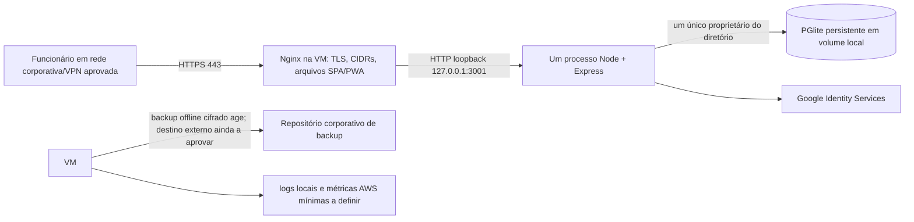

# Etapa 4 — prontidão operacional para staging AWS sem RDS

**Data da verificação:** 15/10/2026  
**Decisão:** GO para preparação e homologação sintética planejada; **NO-GO para implantação AWS neste momento**. Nenhum recurso AWS foi criado/modificado e nenhum deploy foi executado.

## Resumo executivo

O checkout contém as correções de segurança e os instrumentos de medição das Etapas 2 e 3. O HEAD atual é `94a7684e4a0f448ab244d801c43c4e4d2f3850ec`, na branch `login-integracao`; antes desta auditoria o worktree estava limpo. O código de staging exige allowlist por pessoa, validação Google, segredo HMAC explícito, origem HTTPS explícita, diretório PGlite e `TRUST_PROXY` declarado; liga a API somente em loopback. Os endpoints de dados, cases, leaderboard e dados pessoais exigem autenticação em `staging`/`production`, e o endpoint legado de criação anônima é desativado nesses ambientes.

O candidato técnico continua sendo uma única VM Linux, Nginx e um processo Node/Express dono exclusivo do PGlite em disco. A Etapa 3 validou localmente 30 VUs em rajada e num soak de 30,19 minutos, com dados sintéticos e limites Docker 2 vCPU/4 GiB. Não há evidência de AWS, de arquitetura ARM, de comportamento de volume AWS, de acesso pela rede da A3Data, de TLS real, de OAuth real nem de backup criptografado enviado e restaurado fora da máquina.

A recomendação de custo inicial é comparar **Lightsail Linux 4 GB / 2 vCPU** e **EC2 t4g.medium / 2 vCPU / 4 GiB** usando uma calculadora e os requisitos de rede. Lightsail reduz trabalho e agrega CPU, SSD e cota de transferência ao bundle; a página oficial consultada lista US$ 24/mês para 4 GB e US$ 44/mês para 8 GB com IPv4 público, mas preço regional, impostos, snapshots e tráfego excedente precisam ser confirmados. EC2 separa computação, gp3, IPv4, snapshots, métricas e logs; a t4g.medium é Arm e burstable, então ainda não corresponde ao teste x64 e pode gerar custo de créditos em períodos prolongados de CPU alta. Não há base para declarar custo total mensal validado.

Os bloqueios imediatos são decisões e acessos corporativos: região/orçamento, hostname/DNS/TLS, caminho de rede realmente disponível aos funcionários e CIDRs aprovados, dono/processo de manutenção da allowlist, configuração OAuth autorizada, política de backup externo e valores de SLO/RPO/RTO. Sem essa informação, o template fail-closed rejeita todo acesso por rede. A homologação posterior deve usar somente contas e dados sintéticos autorizados.

## Estado verificado do repositório

| Item                | Estado/evidência atual                                                                                                    | Interpretação                                                                                                                                         |
| ------------------- | ------------------------------------------------------------------------------------------------------------------------- | ----------------------------------------------------------------------------------------------------------------------------------------------------- |
| Branch/HEAD         | `login-integracao`, `94a7684e4a0f448ab244d801c43c4e4d2f3850ec`; `git status --short --branch` limpo antes deste documento | Estado revalidado; nenhuma alteração preexistente a reconciliar. Nesta etapa, somente este relatório novo e o script de harness foram alterados.      |
| Etapa 3             | `docs/audits/ETAPA3_LATENCIA_CAPACIDADE.md`, JSON/JSONL em `docs/audits/evidence/2026-10-13/stage3/`                      | As medições continuam sendo Docker/Linux x64 local, não AWS. 30 VUs e soak passaram nos limites propostos; 150 saturou event loop e excedeu p95/p99.  |
| Runtime PGlite      | `DB_ENGINE=pglite`, `backend/database/db.js`, `backend/api/server.js`, diretório configurado por `DB_DATA_DIR`            | Uma instância e um processo devem ser os únicos donos do diretório. O filesystem real e a persistência de disco ainda não foram homologados.          |
| Config de staging   | `backend/api/config.js` valida configuração hardened e o servidor usa `config.host`                                       | Em staging/produção, o bind é `127.0.0.1`; não expor `3001` externamente.                                                                             |
| Conteúdo estático   | `public/` é saída gerada; `docs/audits/staging/nginx/cloudacademy.conf.example` serve `public/`                           | A proteção da SPA, JS, JSON, manifest e SW depende do firewall/rede Nginx corporativa. CORS não impede download direto.                               |
| Segredos/identidade | `backend/api/services/googleIdentity.js`, `sessionToken.js`, `requireRole.js`, `auth.js`                                  | Há autorização individual por `AUTH_ALLOWED_EMAILS` e validação Google; configuração do Google e identidade empresarial real não foram testadas.      |
| Operação/backup     | templates Nginx/systemd e utilitários `scripts/operations/backup-pglite.mjs`, `verify-pglite-backup.mjs`                  | São procedimentos e código local; não provam execução `age`, cópia externa, retenção, restauração fora do host ou RPO/RTO.                            |
| Documentação        | `docs/API_OPERATIONS.md`, `ETAPA2_STAGING_PGLITE.md`, `P0_CONTRATO_STAGING_AWS.md`, `AUDITORIA_PRONTIDAO_DEPLOY_AWS.md`   | Os relatórios de 07/10 e o contrato inicial usam outro HEAD e desenho PostgreSQL/RDS; para este escopo, a Etapa 2 PGlite e o código atual prevalecem. |

### Diferenças documentais relevantes

- `docs/API_OPERATIONS.md` ainda descreve o bind operacional como `0.0.0.0`, mas `validateApiConfig()` retorna `127.0.0.1` em staging/produção. Atualizar o contrato antes de usá-lo como runbook.
- O mesmo documento primeiro limita a recusa de `POST /api/users` a `DB_ENGINE=postgres` e depois o descreve como público. O código atual recusa também quando `NODE_ENV` é `staging` ou `production`; o teste `deploySafety.test.js` verifica os controles de deploy. Não usar essa rota para provisionamento.
- O contrato `P0_CONTRATO_STAGING_AWS.md` descreve caminho baseado em PostgreSQL/RDS e tem HEAD/data históricos. Ele não é autorização nem arquitetura vigente para a presente etapa PGlite.
- A Etapa 3 usou Node 24.21.0, enquanto `docs/API_OPERATIONS.md` cita Node 22. A versão exata de Node a homologar deve ser fixada no pacote/imagem/runbook e o teste de carga repetido nessa versão; não inferir compatibilidade operacional de uma faixa sem `engines`/imagem de produção aprovada.

## Arquitetura considerada



Não colocar duas VMs/processos contra o mesmo `DB_DATA_DIR`. PGlite mantém um estado local por processo/volume; duas réplicas com discos separados divergiriam, e compartilhamento de um diretório de banco entre hosts/processos não está suportado pelo desenho testado. Escala horizontal exige mudança de arquitetura/DB e reconciliação, fora desta etapa. Crescimento seguro enquanto PGlite for mantido é primeiro vertical, depois rever arquitetura quando métricas de CPU, volume, backup/restore ou disponibilidade excederem objetivos aprovados.

Esta topologia é single point of failure: systemd reinicia o processo após falha, mas não prova recuperação automática da VM, da AZ ou do volume. Reboot/host replacement implica indisponibilidade até recuperar host e storage; não há failover sem segundo banco consistente. No EC2, confirmar criptografia e `DeleteOnTermination=false` para o volume persistente e impedir término acidental; em Lightsail, validar o ciclo de vida da instância/snapshot e retenção. Snapshot de VM é cópia complementar e seu restore precisa ser exercitado; o backup PGlite offline cifrado e restaurável fora da máquina é gate independente.

| Alternativa          | Ajuste ao perfil medido                                                          | Compatibilidade                                                                                                                                                                                                                                                                     | Custos e riscos                                                                                                                                                                                                                                                                                      |
| -------------------- | -------------------------------------------------------------------------------- | ----------------------------------------------------------------------------------------------------------------------------------------------------------------------------------------------------------------------------------------------------------------------------------- | ---------------------------------------------------------------------------------------------------------------------------------------------------------------------------------------------------------------------------------------------------------------------------------------------------- |
| Lightsail Linux 4 GB | 2 vCPU, 4 GiB e disco SSD do bundle; mais próximo do limite local testado        | Usar imagem Linux x64 inicialmente para reduzir variáveis; confirmar `uname -m` e o plano disponível na região. Rede Lightsail deve permitir a origem corporativa real.                                                                                                             | A página oficial lista 80 GB SSD, 4 TB de transferência e IPv4 público no bundle de US$ 24/mês; confirmar região, impostos, transferências e snapshots antes de compromisso. O bundle não substitui backup externo.                                                                                  |
| Lightsail Linux 8 GB | 2 vCPU, 8 GiB; maior reserva de memória, mesma contagem de vCPU                  | Mesmas pendências de rede/arquitetura. Não há evidência de que dobrar RAM melhore o gargalo CPU/event loop.                                                                                                                                                                         | Lista oficial consultada: 160 GB SSD, 5 TB e IPv4 por US$ 44/mês. Só justificar se crescimento/margem de memória for medido.                                                                                                                                                                         |
| EC2 t4g.medium       | 2 vCPU, 4 GiB; tamanho parecido ao limite testado, porém outra ISA/modelo de CPU | Arm64/Graviton2 não foi testado. AWS publica baseline de 20% por vCPU e 24 créditos/hora; no modo Unlimited, surplus CPU pode custar US$ 0,04 por vCPU-hora. Node/PGlite/dependências precisam de build, smoke, crash/restore e carga ARM64. Medir créditos e custo em cada ensaio. | Calcular 730 h × tarifa da região + gp3 (GB-mês) + IPv4 público (a tarifa AWS atualmente exibida é US$ 0,005/h, aprox. US$ 3,65 por mês de 730 h) + snapshots + logs/métricas + saída de rede/egress. A tarifa de `t4g.medium` e gp3 deve ser consultada no Pricing Calculator para região/OS/disco. |
| EC2 x86 equivalente  | 2 vCPU/4 GiB para reproduzir mais diretamente o x64 medido                       | Evita a migração de ISA nesta homologação. Perfil/classe exatos dependem da disponibilidade regional; T3 também é burstable, portanto créditos precisam ser considerados.                                                                                                           | Computação, gp3, IPv4, snapshots, observabilidade e transferência discriminados no Calculator. Pode custar mais que Lightsail, mas dá controle de rede, IAM de instância e discos.                                                                                                                   |

Preços consultados em 15/10/2026, sujeitos a alteração e a região: [Lightsail pricing](https://aws.amazon.com/lightsail/pricing/), [t4g e créditos](https://aws.amazon.com/ec2/instance-types/t4/), [EC2 On-Demand e CPU credits](https://aws.amazon.com/ec2/pricing/on-demand/), [IPv4 público](https://aws.amazon.com/vpc/pricing/) e [EBS gp3](https://aws.amazon.com/ebs/pricing/). Lightsail lista disponibilidade em `sa-east-1` e `us-east-1` ([regiões Lightsail](https://docs.aws.amazon.com/lightsail/latest/userguide/understanding-regions-and-availability-zones-in-amazon-lightsail.html)); disponibilidade não significa que a rota/firewall da empresa funcione. Os valores de bundle apresentados são preços oficiais de página e não uma cotação final por região/tributos.

**Estimativa orçamentária utilizável hoje:** Lightsail 4 GB, US$ 24/mês de bundle listado como âncora de computação/SSD/IPv4/transferência, mais snapshot/backup externo, tributos e extras regionais. Isto não é o total validado nem inclui garantia de backups, operação/SRE, domínio/certificado, monitoramento/alarme ou egress excedente. Para EC2, não há total informado: usar a fórmula da tabela e a calculadora com parâmetros aprovados, sem assumir uma tarifa não consultada. Região, retenção, transferência e monitoramento alteram o total. Sem CIDR corporativo e custo aprovado, não pedir provisionamento.

## Segurança e prontidão operacional

| Controle                  | Estado                                                                | Evidência e pendência                                                                                                                                                                                                                                                                                                                                                                                                                                                                                        |
| ------------------------- | --------------------------------------------------------------------- | ------------------------------------------------------------------------------------------------------------------------------------------------------------------------------------------------------------------------------------------------------------------------------------------------------------------------------------------------------------------------------------------------------------------------------------------------------------------------------------------------------------ |
| Allowlist individual      | **Implementado; validado localmente; operação pendente**              | `AUTH_ALLOWED_EMAILS` explícito é obrigatório em staging/produção e fail-closed; e-mail é revalidado em cada request autenticado. A3Data precisa determinar IdP/grupo ou owner da lista, lista de test identities autorizadas e procedimento de desligamento. Não preencher emails/domínios por inferência.                                                                                                                                                                                                  |
| Google OAuth              | **Código e mocks locais; homologação externa pendente**               | Verifica assinatura/audience usando Client ID configurado, issuer, validade, `email_verified`, domínio permitido e autorização individual. Faltam client id/origens/redirect/consent e teste browser com conta corporativa; nada foi consultado no Google Console.                                                                                                                                                                                                                                           |
| Revogação/desligamento    | **Mecanismo local; processo organizacional pendente**                 | Desativação no DB impede sessão, e remoção da allowlist dá 403 no request API seguinte. Token HMAC tem TTL de 8 h; usuário/allowlist são relidos por request, então não depende de aguardar o TTL. Definir owner e SLA de revogação. Cópias locais já armazenadas no Cache API/PWA não podem ser apagadas remotamente; classificar conteúdos e aplicar MDM/limpeza se exigido.                                                                                                                               |
| Roles e dados do usuário  | **Implementado e coberto por testes locais**                          | `requireAuth`, `requireRole` e verificação dono/admin protegem quiz, perfil, progresso, revisão e admin. Rotas de questions/cases/services/leaderboard exigem funcionário autenticado em staging/produção. Repetir smoke com identities não autorizadas no staging real.                                                                                                                                                                                                                                     |
| Superfície estática/API   | **Configuração proposta, borda não homologada**                       | Nginx exige rede aprovada para todo o host, incluindo HTML/JS/JSON/SW. `approved-cidrs.map.example` está em deny-all; hostname e certificado são placeholders. CORS limita chamadas de browser, mas não autentica nem impede acesso HTTP direto.                                                                                                                                                                                                                                                             |
| Bind e firewall           | **Bind validado por testes/config; infraestrutura pendente**          | Config hardened liga Node em `127.0.0.1`. Confirmar em Linux `ss -lntp` e firewall/security group sem 3001 externo. Rede corporativa/VPN/proxy não identificada; sem inventar perímetro, o acesso deve permanecer bloqueado.                                                                                                                                                                                                                                                                                 |
| TLS/Nginx                 | **Template estático; não validado com Nginx real**                    | TLS 1.2/1.3, HSTS, headers, proxy loopback e CIDR guard estão em `cloudacademy.conf.example`; certificado, hostname, include de CIDR e `nginx -t` dependem do host e de owners de rede/DNS/PKI.                                                                                                                                                                                                                                                                                                              |
| CORS/proxy/rate limit     | **Guardas locais; valor operacional pendente**                        | Origens HTTPS exatas e `TRUST_PROXY` explícitos são exigidos no hardened mode; configuração de proxy valida IP/CIDR, não aceita “trust all”. Rate limit tem 300 requests/15min e identidade assinada ou IP; provar IP real após Nginx e calibrar probes sem enfraquecer limite.                                                                                                                                                                                                                              |
| Segredo de sessão         | **Validação local; gestão/rotação pendente**                          | Staging requer `AUTH_SESSION_SECRET` de pelo menos 32 bytes e rejeita placeholders; armazenamento deve ser fora do repo, permissões mínimas e valor constante nos restarts. Rotação encerra sessões. Aprovar fonte de segredo e acesso de operadores.                                                                                                                                                                                                                                                        |
| Health/readiness/shutdown | **Implementado e validado localmente**                                | `/api/health` mede liveness; `/api/ready` valida configuração e banco com timeout. SIGTERM inicia drain único, desativa readiness, fecha HTTP e depois DB. Aplicar `TimeoutStopSec`/grace maior que 15 s e validar no Linux; ambos endpoints seguem rate limit e devem ficar atrás da rede aprovada.                                                                                                                                                                                                         |
| Logs/métricas             | **Operação pendente; log PGlite insuficiente para SRE**               | O middleware sempre devolve request ID, mas no caminho `DB_ENGINE=pglite` o log atual registra apenas timestamp e método; rota/status/duração/request ID não são estruturados como no runtime PostgreSQL. Não há collector/alarme instalado. Definir logging sanitizado (sem tokens, corpos ou PII), journald/CloudWatch, retenção e custo. Incluir CPU/memória/disk/inodes/restarts, `ready`, event-loop lag e, para T4g, `CPUCreditBalance`/`CPUSurplusCreditsCharged`.                                    |
| PGlite persistente        | **Crash/restart local validado; volume AWS não validado**             | Diretório obrigatório e um processo proprietário. Teste da Etapa 3 não cobre desligamento abrupto de host, detach/reattach, snapshot ou filesystem de AWS. Usar volume persistente, backup antes de versão, alertar disco cheio e nunca compartilhar diretório ativo.                                                                                                                                                                                                                                        |
| Backup/restore            | **Utilitário preparado; criptografia/off-host/restore AWS pendentes** | `backup-pglite.mjs` requer serviço parado, chama `syncToFs()` e `dumpDataDir('gzip')`, criptografa com `age`, grava arquivo exclusivo e hash. `verify-pglite-backup.mjs` restaura apenas em diretório inexistente e verifica tabelas/contagens. `age` e armazenamento externo não foram exercitados; retenção, chaves, RPO/RTO, cópia off-host e restore periódico precisam de aprovação/teste. O dump é materializado em memória: medir pico RSS com volume de staging antes de agendar em uma VM de 4 GiB. |
| Rollback                  | **Planejado, sem ensaio AWS**                                         | Reverter versão de código é possível só se schema/API continuarem compatíveis; preservar diretório original e backup, validar schema, e restaurar em path novo. Definir runbook, operador, janela e critério de rollback antes do canário.                                                                                                                                                                                                                                                                   |

Não há RDS, DynamoDB, cache distribuído, cluster nem balanceador necessários para o candidato single-node. Também não há justificativa concreta para Iceberg, que é tecnologia de analytics/data lake, não banco operacional para login, tentativas e progresso transacional.

## Resultado dos testes/revisões desta etapa

- Estado Git e fontes/documentos: HEAD e status observados; nenhum runtime da aplicação foi alterado. O harness ganhou opção segura para preservar repetições de evidência em diretórios exclusivos.
- `Parser::ParseFile` do PowerShell: sem erros; casos de caminho escapando da raiz e diretório de evidência existente foram rejeitados antes de qualquer chamada Docker.
- `npm test -- --runInBand --runTestsByPath __tests__/apiOperations.test.js __tests__/deploySafety.test.js __tests__/auth401.test.js __tests__/sessionToken.test.js`: **4 suites, 43 testes aprovados** no checkout atual.
- `npm test -- --runInBand`: evidência existente da Etapa 3 em `stage3/jest-stage3-final.log`: 98 suites/841 testes aprovados, 8 suites e 107 testes ignorados conforme a configuração daquele run. Não repetido integralmente nesta etapa porque não houve mudança de runtime.
- Carga e soak: evidência sintética existente da Etapa 3; matriz única (não repetida nesta etapa), soak 30,19 min e crash/restart local. Não é homologação AWS.
- Backup criptografado/restaurado: **não executado nesta etapa**; a Etapa 2 registra que o binário `age` não estava instalado. Não afirmar como aprovado.
- Nginx, systemd e arquitetura EC2/Lightsail: revisão estática dos templates; `nginx -t`, `systemd-analyze verify`, `ss`, firewall e smoke remoto não executados por não haver host.
- Navegador/OAuth Google corporativo, ARM64/Graviton, volume AWS, restore externo e rede da A3Data: não testados.

## Checklist de preparação

### Antes de reservar/provisionar ambiente (decisão A3Data)

1. Aprovar owner, região, orçamento mensal e política de classificação/residência de dados; cotar Lightsail 4 GB versus EC2 com parâmetros completos.
2. Informar a topologia real de acesso: VPN, proxy corporativo ou egress fixo aprovado; ranges devem ser obtidos do owner, não inventados. Confirmar disponibilidade a partir de laptops/VDI e gestão de DNS.
3. Aprovar hostname, zona DNS, certificado/renovação e escopo de Security Group/firewall (80 somente para redirect se necessário; 443 apenas egress corporativo; 22 fechado ao público; 3001 apenas loopback).
4. Definir política de identidade: origem da allowlist individual, owner e processo de entrada/desligamento, identities sintéticas autorizadas e Google OAuth Client ID/origens homologadas. Nenhum usuário real antes disso.
5. Aprovar segredo, operador de backup/restore, storage off-host existente e identidade/chaves `age`; definir retenção, frequência, RPO, RTO e autorização de restauração.
6. Aprovar SLOs e volume realista de carga; limites p95 1,5 s/p99 3,5 s para 30 são proposta, não requisito vigente até assinatura pelo owner de produto.
7. Fixar Linux, ISA, Node, versão de aplicação/PGlite, volume/mount, capacidade e política de patches. Para EC2 t4g, exigir artefato ARM64 testado; considerar EC2 x86 ou Lightsail x64 como candidato de primeira homologação.

### Execução autorizada de staging sintético (não feita nesta etapa)

1. Construir release imutável e registrar SHA, Node/PGlite, schema/migrations e SBOM; instalar em host novo e isolado sem dados reais.
2. Montar volume persistente com owner/permissões de serviço e `DB_DATA_DIR` absoluto; configurar `NODE_ENV=staging`, `DB_ENGINE=pglite`, porta 3001 e segredos fora do checkout. Usar somente emails sintéticos explicitamente adicionados à allowlist de staging e Google OAuth aprovado.
3. Instalar Nginx/systemd só após substituir placeholders pelos dados fornecidos. Fazer `nginx -t` e validar listener Node em loopback, firewall restrito e TLS confiável de cliente corporativo.
4. Executar smoke: GET `/api/health` (200), GET `/api/ready` (200 após DB), conteúdo estático permitido somente da rede autorizada, login Google sintético, `/api/auth/me`, iniciar/responder/finalizar quiz, resultado, stats/progresso, logout/revogação e fluxo sem sessão (401)/sem allowlist (403). Verificar que `/api/users` dá 403, admin requer role e porta 3001 não responde fora do loopback.
5. Usar gerador Stage3 em host/container separado do servidor; estabelecer baseline sem usuários, depois 10, 30, 50 e 150 VUs. Fazer no mínimo três execuções independentes de cada degrau com limpeza/recriação **apenas do banco efêmero sintético**, seed determinístico e pausas documentadas; preservar cada JSON/CSV e versão do build. O cenário 150 permanece stress.
6. Em 30 VUs, manter o perfil de think time aprovado por pelo menos 30 minutos; coletar p50/p95/p99 total e por rota, RPS, status/erros, CPU e créditos, RSS/heap, event loop, disco/IO, bytes do PGlite, contagens de usuário/quiz/resposta/duplicatas e crescimento de arquivos.
7. Fazer reinício graceful e abrupto da aplicação usando banco descartável; confirmar readiness e integridade após cada um. Testar retenção do volume após stop/start e, em cópia isolada, snapshot/recuperação do host conforme o provedor.
8. Executar backup em janela offline, verificar hash/arquivo cifrado, enviar para destino externo já aprovado, restaurar em host/path separado usando identidade distinta e comparar schema/contagens/checksum funcional; medir duração, pico RSS, RPO alcançado e RTO.
9. Retomar teste após restore; revisar logs/alertas/custos reais. Guardar evidências sanitizadas e retirar os dados sintéticos ao encerrar staging conforme política do ambiente.

Comandos Linux para o canário (após aprovação; placeholders devem ser preenchidos por operadores autorizados):

```bash
sudo nginx -t
sudo systemd-analyze verify /etc/systemd/system/cloudacademy-api.service
sudo systemctl start cloudacademy-api
sudo systemctl is-active cloudacademy-api
sudo ss -lntp | grep ':3001'  # exclusivamente 127.0.0.1:3001
curl -fsS https://<hostname-aprovado>/api/health
curl -fsS https://<hostname-aprovado>/api/ready
```

Harness local já registrado, fora da rede AWS e do processo API. Nesta etapa foi incluído `-EvidenceDirectory`: quando informado, deve ser uma nova pasta relativa dentro do repositório; o script rejeita caminho absoluto, escape da raiz e destino existente, preservando medições anteriores. Para três repetições independentes da matriz e um soak em diretório distinto:

```powershell
powershell -NoProfile -ExecutionPolicy Bypass -File scripts/diagnostics/run-stage3-linux.ps1 -MatrixOnly -EvidenceDirectory docs/audits/evidence/2026-10-15/stage4/matrix-01
powershell -NoProfile -ExecutionPolicy Bypass -File scripts/diagnostics/run-stage3-linux.ps1 -MatrixOnly -EvidenceDirectory docs/audits/evidence/2026-10-15/stage4/matrix-02
powershell -NoProfile -ExecutionPolicy Bypass -File scripts/diagnostics/run-stage3-linux.ps1 -MatrixOnly -EvidenceDirectory docs/audits/evidence/2026-10-15/stage4/matrix-03
powershell -NoProfile -ExecutionPolicy Bypass -File scripts/diagnostics/run-stage3-linux.ps1 -SoakSeconds 1800 -ThinkMilliseconds 5000 -EvidenceDirectory docs/audits/evidence/2026-10-15/stage4/soak-30m
```

Cada processo constrói banco sintético novo e efêmero, preserva evidência em pasta própria e confere integridade. A execução `soak-30m` também repete a matriz e acrescenta o soak, portanto gera uma quarta amostra da matriz. Em AWS, não rodar teste externo até haver aprovação específica da rede/conta e janela. A porta do harness é local e diferente da porta API padrão.

## Go/No-Go objetivo

**GO para primeiro acesso de funcionários em staging somente quando todos forem verdadeiros:**

- Produto aprova SLO p95/p99 e cenário operacional, e A3Data aprova região, orçamento, dados sintéticos, hostname, TLS, rede/identidade e owners.
- Teste de borda demonstra HTTPS válido, 403 fora da rede aprovada, acesso interno permitido, 3001 não público e origem/forwarding corretamente observados pelo rate limiter.
- Google login aceita apenas identidade allowlisted/ativa; e-mail fora da lista recebe 403; conta desativada ou removida perde API imediatamente; usuário não alcança dados de outro; admin endpoints exigem role.
- Smoke frontend→API→PGlite completo e fluxos de estudo, sync e reload funcionam; conteúdos cacheados têm classificação de confidencialidade aprovada.
- Três repetições do degrau de 30 VUs passam nos SLO aprovados; soak ≥30 minutos passa sem erros funcionais/duplicações/perda, sem tendência de crescimento de RSS ou degradação; 150 VUs documentados como teste de estresse sem corrupção.
- Persistência sobrevive restart; backup criptografado está fora do host, retenção confirmada, hash/manifest registrados e restore em isolamento atingiu RPO/RTO aprovados e integridade esperada.
- Alarmes mínimos, logs sem token/PII, segredo com acesso limitado, procedimento de incidentes, rollback e responsáveis on-call existem e foram exercitados.

**NO-GO imediato** se algum valor for placeholder, allowlist não for explicitamente gerenciada, rede externa não puder ser restrita, Google OAuth não estiver configurado, armazenamento for efêmero/compartilhado, 3001 ficar acessível fora do loopback, backup estiver apenas no mesmo host, o restore falhar, usuário acessar dados alheios, ocorram duplicatas/perdas, SLO aprovado falhar ou custo não estiver autorizado. Nenhuma média de RSS ou teste local substitui estes gates.

## Pendências dependentes da A3Data

| Decisão/ação                                          | Owner sugerido             | Saída necessária                                                                             |
| ----------------------------------------------------- | -------------------------- | -------------------------------------------------------------------------------------------- |
| Rede de colaboradores: VPN/proxy/egress, CIDRs e rota | Infra/Network/Security     | CIDRs documentados, caminho testável e regras de firewall aprovadas                          |
| Hostname, DNS, TLS e acesso de usuário                | Infra/Network              | FQDN, certificado/renovação, zonas e origem permitida                                        |
| Região, Lightsail ou EC2, limites de custo e conta    | Cloud Platform/FinOps      | Região e plano aprovados, calculator discriminando compute/disk/IPv4/backup/log/transfer/tax |
| Identidade OAuth/grupo/allowlist e desligamento       | Identity/Security/HR owner | Client ID/origens autorizadas, dono e SLA de allowlist, usuários sintéticos aprovados        |
| RPO/RTO, backup externo, retenção e chave             | Data owner/Security/Infra  | Política aprovada, destino existente, custody de `age` e calendário de restore               |
| SLO/carga operacional e aceite funcional              | Product owner/QA           | p95/p99, perfil, erros admissíveis, carga e checklist assinado                               |
| Observabilidade e resposta a incidente                | SRE/Infra                  | Alarmes, retenção, canal/escalation interno e owner de operação                              |

## Recomendação e decisão

Manter PGlite numa única VM e um único processo, sem RDS ou escala horizontal, é defensável para iniciar homologação sintética: 30 usuários passaram localmente e o soak manteve integridade. A primeira hipótese de execução é uma imagem Linux x64 no bundle Lightsail 4 GB, por proximidade do ambiente de carga e simplicidade de custo, **condicionada** à confirmação regional, firewall compatível com a rede A3Data e teste de volume/backup. EC2 x86 é alternativa se a rede, IAM/SSM ou governança de disco exigir mais controle. `t4g.medium` só se torna escolha informada após build ARM64 e teste de créditos/carga no alvo. 8 GB não é justificado apenas por esses dados, pois o RSS máximo observado foi ~616 MiB e a saturação registrada foi CPU/event loop.

**GO:** preparação/documentação e futura homologação sintética sem funcionários reais, depois das aprovações.  
**NO-GO:** implantação em AWS nesta etapa, exposição para funcionários e uso de dados reais. Não há rede/TLS/OAuth/backup externo/AWS testados, e os objetivos SLO/RPO/RTO não foram aprovados.

### Próxima execução técnica, sem iniciar deploy

Abrir a etapa seguinte como **fechamento do contrato do canário PGlite**: obter dos owners da A3Data as decisões acima e revisar este documento com valores concretos; atualizar `docs/API_OPERATIONS.md` para o bind em loopback e a recusa de `/api/users` em staging; executar preflight de configuração/artefato em uma VM Linux descartável ou runner isolado que já esteja autorizado, sem tráfego externo. Depois disso, submeter plano de staging sintético para autorização explícita de provisionamento. Só com essa autorização a execução posterior deve criar uma única instância, testar acesso e persistência e coletar evidências de Go/No-Go. Nenhuma dessas ações remotas foi iniciada.

| Prioridade | Ação                                                            | Justificativa                                                                       | Responsável sugerido                       | Evidência necessária                                                              | Condição de conclusão                                                          |
| ---------- | --------------------------------------------------------------- | ----------------------------------------------------------------------------------- | ------------------------------------------ | --------------------------------------------------------------------------------- | ------------------------------------------------------------------------------ |
| P0         | Aprovar rede/identidade/hostname/região/orçamento e SLO/RPO/RTO | Sem os dados, deny-all é correto e não há contrato de operação                      | A3Data Infra, Identity, Security e Product | Decisões registradas e owners identificados                                       | Todos os valores operacionais deixam de ser placeholder                        |
| P0         | Confirmar artefato Linux x64 ou ARM64, Node e PGlite            | A evidência de capacidade só vale para Linux x64/Node 24.21/Docker local            | Engenharia/DevOps                          | build, `node --version`, `uname -m`, smoke e teste de carga no alvo               | Versões fixadas e matriz compatível validada                                   |
| P0         | Demonstrar TLS e restrição de ingresso, sem 3001 externo        | Arquivos públicos e API não são protegidos por CORS                                 | Network/Security/DevOps                    | `nginx -t`, teste interno/externo, `ss -lntp`, firewall e rate-limit IP observado | Todos os testes de borda passam                                                |
| P0         | Ensaiar backup `age` off-host e restore isolado                 | Arquivos de backup atuais não foram criptografados/restaurados em destino externo   | Data owner/Security/SRE                    | artefato cifrado, hash, storage externo aprovado, contagens/schema, duração/RSS   | Integridade e RPO/RTO aprovados em restore repetido                            |
| P1         | Corrigir `docs/API_OPERATIONS.md` e alinhar versão de Node      | Runbook atual diverge do bind real e tem afirmações conflitantes sobre `/api/users` | Backend/Docs owner                         | revisão de código + testes `apiOperations`/`deploySafety`                         | Documento corresponde ao HEAD e à versão de runtime fixada                     |
| P1         | Repetir três vezes a matriz e soak em staging aprovado          | A evidência atual é uma execução local e não prova variabilidade AWS                | QA/Performance/SRE                         | JSON de cada run, métricas do host/DB/API/client e integridade                    | 3/3 degraus operacionais aprovados e soak ≥30 min dentro dos limites assinados |
| P1         | Configurar logs, alertas, patching, operador e rollback         | Reinício systemd/template não é operação de serviço completa                        | SRE/Cloud Platform                         | logs sanitizados, alarmes, retenção, exercício de rollback/incidente              | Owner consegue detectar e recuperar falha dentro do SLO                        |
| P2         | Medir pico de backup e tendência de crescimento do diretório    | Dump é mantido em buffer de memória; dados sintéticos não dimensionam volume real   | Backend/SRE                                | RSS/tempo durante dump, bytes/dia e margem de volume                              | Reserva de RAM/disco e janela operacional aprovadas                            |
